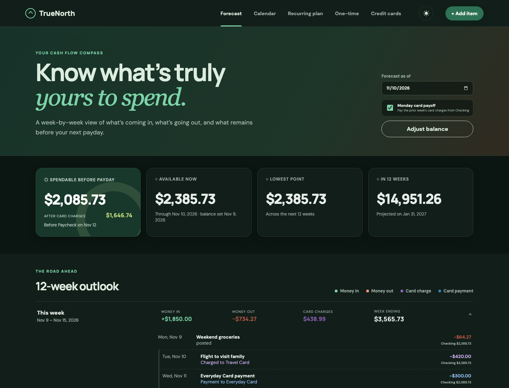
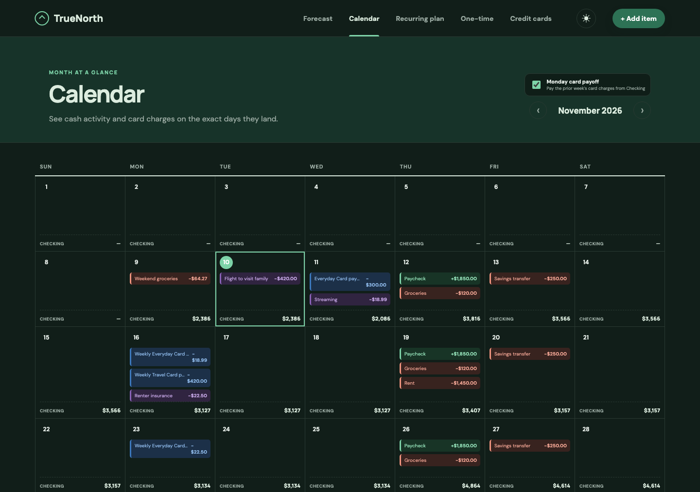

# TrueNorth Budget

TrueNorth is a private, local-first cash-flow planner that answers a practical question: **how much money is actually safe to spend before the next payday?**

It combines recurring income, bills, one-time activity, and credit-card spending into a week-by-week forecast. There is no account, bank connection, or cloud database—your information stays in a local SQLite file.



_Screenshots use fictional demo data._

## Know what is safe to spend

The Forecast view rolls your saved Checking balance forward from its “as of” date and shows:

- Spendable cash immediately before the next expected income.
- Available cash through the selected day.
- The lowest projected balance and the 12-week ending balance.
- A running Checking balance beneath every forecast item.
- Separate visual treatment for cash expenses, card charges, and card payments.
- An optional Monday payoff that moves the prior week’s card charges out of Checking.

## See the month as it happens

The Calendar view places every expected payment on the day it lands and keeps a projected end-of-day Checking balance visible in each cell.



Select a day to add a one-time payment or review, edit, and delete planned activity. Notes stay visible in the day detail, while hover details show card-aware Checking balances and the projected balance after a card payment posts.

## Plan recurring cash flow and card debt

- Schedule income and expenses weekly, biweekly, monthly, quarterly, or yearly.
- Schedule activity on a weekday or an ordinal weekday, such as the third Thursday of every month.
- Add one-time planned or posted income and expenses.
- Assign purchases to Checking or a saved credit line.
- Direct payments to a credit line so they reduce its projected balance.
- Track card balances, limits, APRs, due days, minimum payments, and utilization.
- Switch between light and dark themes.

## Private by design

TrueNorth binds to `127.0.0.1` by default and stores its data in `data/budget.db`. The database, environment files, logs, PID files, and financial exports are ignored by Git.

Do not expose the server on a public interface unless you add authentication and understand the network risk.

---

## Setup

### Requirements

- Python 3.10 or newer
- No third-party Python packages

Clone and run:

```bash
git clone https://github.com/ivanrsalazar/budget_app.git
cd budget_app
python3 server.py
```

Open <http://127.0.0.1:8000>. The SQLite database is created automatically on first launch.

### Run in the background on a custom port

This example runs TrueNorth on port `8123`, sends output to `budget.log`, and saves the process ID to `budget.pid`:

```bash
BUDGET_PORT=8123 nohup python3 server.py > budget.log 2>&1 & echo $! > budget.pid
```

Open <http://127.0.0.1:8123>. Replace `8123` with any available port.

Check whether it is running:

```bash
ps -p "$(cat budget.pid)"
```

Follow its logs:

```bash
tail -f budget.log
```

Stop it and remove the saved PID:

```bash
kill "$(cat budget.pid)"
rm budget.pid
```

### Optional environment configuration

Copy `.env.example` as a reference for the available values. The server reads environment variables from the shell; it does not load `.env` automatically.

```bash
BUDGET_HOST=127.0.0.1
BUDGET_PORT=8000
BUDGET_DB=/absolute/path/to/budget.db
```

### Run the tests

```bash
python3 -m unittest discover -s tests -v
```

## Data and backups

Stop the app before copying `data/budget.db` as a backup. To start over, move that file somewhere safe and restart the server.

Before pushing to a public repository, confirm that `git status` does not show any database, `.env`, CSV/XLSX export, log, or PID file. These are already covered by `.gitignore`, but they should still be reviewed before every public push.
